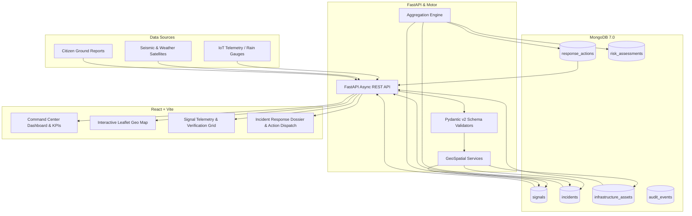

# SignalSutra AI — Architecture & Engineering Specification

## 1. System Overview

**SignalSutra AI** is a real-time disaster signal intelligence and emergency command center system backed by MongoDB and FastAPI. It continuously ingests disparate environmental and sensor telemetry (floods, earthquakes, fires, rainfall, landslides), correlates them into multi-hazard incidents, calculates multi-factor risk scores, and orchestrates tactical emergency response operations.

---

## 2. Technology Stack

| Layer | Component | Version | Role |
|---|---|---|---|
| **Database** | MongoDB | 7.0+ | Primary datastore, GeoJSON spatial index, JSON schema validation, Aggregation pipelines |
| **Backend Driver** | Motor (Async PyMongo) | 3.7+ | Non-blocking asynchronous I/O with asyncio |
| **API Framework** | FastAPI | 0.111+ | Asynchronous REST API, OpenAPI 3.1 documentation |
| **Data Validation** | Pydantic v2 | 2.7+ | Strict schema validation, coordinates boundary checks, serialization |
| **Frontend Framework** | React + Vite | 18.3+ / 6.0+ | Reactive single-page application with hot module replacement |
| **Mapping Engine** | Leaflet | 1.9+ | Interactive Dark CARTO map with GeoJSON coordinates & custom markers |
| **Data Visualizations** | Recharts | 2.12+ | Area charts, severity distribution bars, signal category donuts |
| **Design System** | Custom Glassmorphism CSS | CSS3 | Dark-themed glass tokens, CSS variables, micro-interactions |

---

## 3. MongoDB Collection Schemas & Data Model

### 3.1 `signals`
Stores raw and normalized sensor signals, telemetry observations, and citizen reports.
- **`location`**: GeoJSON `Point` (`[longitude, latitude]`)
- **`signalType`**: Enum (`rainfall`, `flood`, `earthquake`, `landslide`, `fire`, `wind`, etc.)
- **`severity`**: Enum (`low`, `moderate`, `high`, `critical`)
- **`verificationStatus`**: Enum (`verified`, `unverified`, `pending`, `rejected`)
- **`observation`**: Subdocument `{ value: float, unit: string, description: string }`
- **`source`**: Subdocument `{ type: string, name: string, sourceId: string }`
- **`observedAt`**: Date timestamp of observation
- **`tags`**: Array of string classification tags

### 3.2 `incidents`
Represents correlated disaster events that synthesize multiple signals into a manageable hazard event.
- **`title`**: Disaster title
- **`incidentType`**: Category of incident (`flood`, `earthquake`, `industrial`, etc.)
- **`severity`**: Event severity
- **`status`**: Lifecycle stage (`detected` -> `monitoring` -> `active` -> `contained` -> `resolved`)
- **`region`**: Subdocument containing center GeoJSON `Point`, `radiusKm`, and zone name
- **`linkedSignalIds`**: Array of ObjectId string references to correlated signals

### 3.3 `infrastructure_assets`
Critical infrastructure (hospitals, shelters, dams, power plants, fire stations, helipads).
- **`name`**: Facility name
- **`assetType`**: Enum (`hospital`, `shelter`, `helipad`, `dam`, `power_plant`, etc.)
- **`location`**: GeoJSON `Point`
- **`availabilityStatus`**: Enum (`operational`, `partial`, `offline`, `destroyed`)
- **`capacity`**: Integer bed/resource capacity
- **`contactInfo`**: Emergency contact hotline

### 3.4 `response_actions`
Tactical dispatch operations assigned to rescue units.
- **`incidentId`**: Associated incident ObjectId string
- **`title`**: Action headline
- **`actionType`**: Enum (`evacuate`, `deploy_team`, `distribute_supplies`, `medical_response`, etc.)
- **`priority`**: Enum (`low`, `medium`, `high`, `critical`)
- **`status`**: Lifecycle stage (`planned`, `in_progress`, `completed`, `cancelled`)
- **`assignedTo`**: Named agency or tactical unit
- **`estimatedDurationMinutes`**: Expected mission duration
- **`linkedAssetIds`**: Critical assets involved in the action

### 3.5 `risk_assessments`
Multi-criteria risk scoring for affected disaster areas.
- **`incidentId`**: Associated incident ObjectId
- **`overallScore`**: Composite score from 0.0 to 10.0
- **`riskLevel`**: Classification (`low`, `moderate`, `high`, `critical`)
- **`factors`**: Array of evaluated criteria `{ factor, weight, score, description }`
- **`recommendations`**: Actionable directives for disaster managers

---

## 4. MongoDB Indexing Strategy

To guarantee sub-10ms response times on high-volume geospatial and temporal queries, the following indexes are maintained:

1. **Geospatial 2dsphere Indexes**:
   - `signals.location`: `2dsphere` — supports `$nearSphere` and `$geoWithin` queries for radius-based alert detection.
   - `incidents.region.center`: `2dsphere` — enables searching incidents intersecting geographic regions.
   - `infrastructure_assets.location`: `2dsphere` — powers emergency asset allocation within proximity of disaster zones.

2. **Compound Filtering Indexes**:
   - `signals`: `{ signalType: 1, severity: 1, observedAt: -1 }` — covers common dashboard filter combinatorics.
   - `incidents`: `{ status: 1, severity: 1, updatedAt: -1 }` — accelerates active incident triage.
   - `response_actions`: `{ incidentId: 1, status: 1 }` — indexes operational tasks by incident.

3. **Full-Text Search Indexes**:
   - `incidents`: `{ title: "text", description: "text" }` — enables natural language search across incidents.

---

## 5. Aggregation Pipelines

The system leverages MongoDB aggregation pipelines for real-time statistical synthesis:

- **Dashboard Statistics (`dashboard_service.py`)**:
  - Aggregates signals by severity using `$group` and `$sort`.
  - Aggregates signals by category type.
  - Aggregates daily telemetry timeline over the past 30 days using `$dateToString` with `$gte` match filters.
  - Computes global average risk score across active risk assessments.

- **Geospatial Proximity Queries (`signal_service.py`, `asset_service.py`)**:
  - Leverages `$nearSphere` with `$maxDistance` (in meters) to query facilities and sensors within a user-specified radius.

---

## 6. Security & Production Readiness

- **CORS Configuration**: Restricts access to authorized frontends via environment variables.
- **Async Non-blocking Architecture**: Built with Motor to handle concurrent I/O operations efficiently without blocking event loops.
- **Graceful Lifecycle Management**: FastAPI `lifespan` handler safely connects on startup, checks cluster ping, verifies indexes, and closes connections on shutdown.
